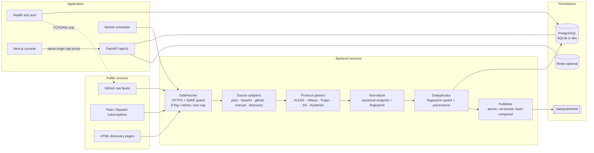

# Architecture

## 1. System context

ADAN NEXUS | CONNECT sits **beside** the existing public subscription pipeline, never inside
it. The GitHub repository `Adan03ac/ADAN-V2Ray-Free-Pack` continues to publish
`subscription.txt`, `subscription_base64.txt` and `status.json` hourly. This application reads
public feeds (including that published bank) and stores its own derived telemetry.



## 2. Layering

| Layer | Location | Responsibility |
| --- | --- | --- |
| Presentation | `frontend/app`, `frontend/components` | Shell, pages, charts, forms, i18n/RTL |
| HTTP API | `backend/app/api/v1` | Versioned routing, validation, status codes |
| Authentication | `backend/app/api/deps.py`, `core/security.py` | Sessions, RBAC, CSRF, rate limits |
| Business logic | `backend/app/services` | Pipeline, testing, exports, analytics |
| Persistence | `backend/app/models.py`, `core/db.py` | Normalized schema, sessions |
| Background jobs | `backend/app/workers` | Single scheduler, health thread pool, retention |
| Source adapters | `services/adapters.py` | Format-specific decoding, discovery handling |
| Protocol parsers | `services/parsers.py` | Independent, pure, unit-tested |
| Subscription exporters | `services/subscriptions.py` | Filtering, rendering, token lifecycle |
| Deployment providers | `services/publisher.py`, `api/v1/cloudflare.py` | Provider protocol, local implementation, explicit stubs |

The API knows nothing about source formats; adapters know nothing about protocols; parsers know
nothing about the database. That keeps each boundary independently testable.

## 3. Ingestion run lifecycle

1. **Single-flight guard** — a file lock (`PIPELINE_LOCK_PATH`) plus a stale-run check. A second
   request returns `409` rather than duplicating work.
2. **Run row** — `pipeline_runs` is created with `status=running` before any network call.
3. **Per source** — `_process_source`:
   - adapter resolution (`plain_text`, `base64`, `github_raw`, `manual`, `html_discovery`)
   - `SafeFetcher.fetch` with conditional headers and redirect re-validation
   - decode, collect links, parse each into a normalized candidate
   - fingerprint dedupe inside the feed, then chunked existence query (400 at a time)
   - bulk insert new configurations, link provenance, refresh `last_seen_at` and occurrences
   - commit per source; a crash is caught and recorded without aborting siblings
4. **Publication** — snapshot query → plain + Base64 + `status.json` + `manifest.json` → hash
   compare against the previous manifest → atomic replace (skipped when unchanged).
5. **Finalization** — status `succeeded | partial | failed`, duration, per-source detail JSON,
   retention pruning.

### Why canonical identity matters

```
vless://<uuid>@1.2.3.4:443?type=ws&security=tls&sni=a.example&path=/x#Nice%20Name
              └─────────────── identity ────────────────────────┘
```
`fingerprint = sha256("protocol|host|port|transport|security|sni|path|pbk|mode" + sha256(credential)[:24])`.
Labels, emoji and fragment text never affect identity; changing UUID/port/SNI does.

## 4. Data model

| Table | Purpose |
| --- | --- |
| `users` | Operators, role (`admin` / `read_only`), lockout counters |
| `auth_sessions` | Hashed session token, CSRF token, expiry, revocation |
| `sources` | Registry: type, URL, trust, tags, interval, fetch metadata, counters |
| `source_fetches` | Every attempt: HTTP status, bytes, durations, counts, diagnostics |
| `configurations` | Normalized config, encrypted raw link, statuses, latency samples |
| `configuration_sources` | Many-to-many provenance with first/last seen and occurrences |
| `health_tests` | One row per test: stage reached, latency, category, agent label/region |
| `health_test_jobs` | Queue/worker visibility and per-job counters |
| `subscription_profiles` | Filters, limits, sort, format, exclusions |
| `subscription_tokens` | SHA-256 hashes of revocable public tokens |
| `pipeline_runs` | Run history, counts, publication outcome, per-source detail |
| `deployments` | Cloudflare placeholder records (empty by design) |
| `audit_logs` | Privileged actions with actor, IP, outcome |
| `settings` | Operator preferences (environment variables win at boot) |

Indexes cover protocol, connectivity status, first-seen, latency, source/provenance joins, run
history and audit timestamps. Alembic owns schema creation outside development.

Retention: `source_fetches` 30 d, `health_tests` 90 d, `pipeline_runs` 90 d (keeping the most
recent 200). Configurations are never auto-deleted — the bank is the product.

## 5. Health testing states

```
UNTESTED ──syntax ok──► VALID FORMAT ──DNS──► DNS RESOLVED ──TCP──► REACHABLE
     │                       │                  │                     │
     └───────────── failure ──┴──────────────────┴────► FAILED / UNKNOWN
CONNECTED  ← intentionally unreachable: no protocol handshake implementation
```

The worker enforces `HEALTH_MAX_BATCH`, a bounded thread pool (`HEALTH_CONCURRENCY`, max 16) and
socket timeouts. Only rows already present in `configurations` can be tested; the API rejects
unknown ids. No port scanning: hosts and ports come exclusively from parsed configuration data.

## 6. Failure behaviour

| Failure | Observed behaviour |
| --- | --- |
| One source times out | Run `partial`; other sources commit; error stored on source + fetch |
| Every source fails | Run `failed`; publication skipped; previous bank untouched |
| Output unchanged | Publication skipped with reason; no redundant commit |
| Parser crash on hostile input | Converted to `ParseError`, counted invalid, run continues |
| Duplicate trigger | `409` (in-process) / file lock (cross-process) |
| Redis unavailable | In-memory cache + rate limiter fallback |
| GitHub unavailable | Dashboard keeps serving stored telemetry; upstream card shows unavailable |
| Database unreachable | `/system/health` returns `degraded`; UI shows the offline banner |

## 7. Deployment topology

- **Frontend** — Next.js standalone server, rewrites `/api/*` to the backend so cookies stay
  first-party. No token in browser storage.
- **Backend** — uvicorn, `alembic upgrade head` on start, non-root user, health check.
- **Worker** — same image, `python -m app.workers.worker`; the only scheduler in Docker.
- **PostgreSQL / Redis** — internal network only, no published ports.
- **Volume** — `appdata` holds the published mirror and the pipeline lock.

Migration path to Iran-hosted infrastructure: every dependency is open source and self-hostable
(PostgreSQL, Redis, Node, Python). No hosted SaaS is required. `PUBLIC_BASE_URL`, `ALLOWED_ORIGINS`,
`DATABASE_URL`, `REDIS_URL` and `PUBLISH_MODE` are the only values that change. Nothing in the code
assumes GitHub or Cloudflare beyond clearly isolated adapters/providers.
